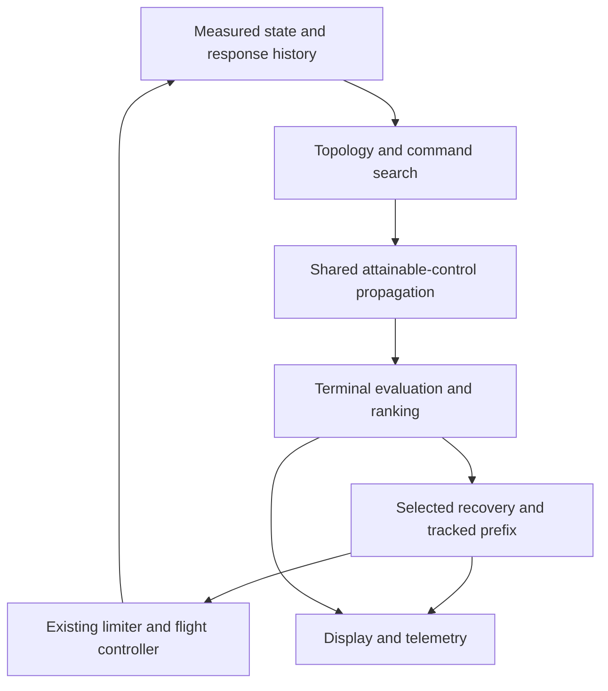

# KSL TAEM/MM305: replacing geometric recovery with attainable trajectory planning

**Engineering research and focused recorded-flight diagnostics — 2026-11-03 (Asia/Seoul)**

Repository: `/Users/kyooni18/Code/KSL`

Backend examined: `swift/KSL-Landing`

Source baseline: `63b0eb3de34d48bfdc08df7c4e0c77abacf12c49`

Primary flight: `runs/20261102T152517Z-dessert-150ms-live/`

## Decision

Replace the current sequence of **choose geometry → reject its descent/force demand → keep pursuing its join** with a **topology-seeded, dynamically propagated receding-horizon planner**. Its first implementation should search a small deterministic family of actual command schedules and refine those schedules with a bounded shooting predictor–corrector. Every candidate must pass through the same attainable-command model, finite pitch/roll response, aerodynamic evaluation, atmosphere, and terminal continuation. Generate the spatial reference from that propagation.

The central change is to make vertical support and turning a joint trajectory decision. Maintaining the old altitude profile is not a physical law. A turn can deliberately reduce the lift component supporting the descent, but its altitude loss, speed change, drag work, future force authority, and eventual flare/stop requirements must all be charged to that candidate. Neither unrestricted banking nor another shortest-path heuristic is a sufficient replacement.

Consider direct continuation, either turning direction, long same-direction turns, extra winding, return HACs, and left–right/right–left reversals. Their angles, timing, and join states are variables. This report does **not** establish that any such maneuver would have landed the recorded flight.

Keep runway qualification, physical evaluability, and control ownership separate. A fully propagated runway miss can be a useful recovery. A rejected geometric proposal with an unpriced suffix cannot become an executable trajectory. When no runway solution is found, continue the best consistently evaluated attainable recovery and preserve the existing low-level protections.

## 1. Scope, evidence, and provenance

The required Foundation Memory search for **“KSL TAEM capture”** preceded the investigation. Relevant original records were retrieved rather than relying only on search-result claims. The configured Yeet Foundation URL was unreachable; the same service was accessed through its documented, authenticated local endpoint. No connection configuration was changed. The prior memory records are leads, not independent confirmation of the flight analysis below. [M1–M5]

`AGENTS.md` was read. No nested `AGENTS.md` was found in the relevant repository tree. The work was limited to source/document inspection, primary-literature research, and deterministic extraction from genuine recorded telemetry. No live flight, kRPC session, save operation, thrust command, build, test suite, new trajectory simulation, synthetic capability change, or broad campaign was executed for this research. Existing uncommitted work was fingerprinted and excluded from the research commit.

### 1.1 Flown identity and limits of reconstruction

| Item | Verified evidence |
|---|---|
| Declared flown source | `63b0eb3de34d48bfdc08df7c4e0c77abacf12c49`; archived `source.patch` is empty. The current backend has no tracked difference from that revision and no untracked source files. |
| Frozen executable | `ksl-landing`, 6,090,664 bytes; SHA-256 `3acb2d76e9264e90e1059bd955bdda75386f4eb2e5863f91328bbd8ba04d7063`, matching the manifest and archived command path. |
| Input configuration | SHA-256 `a07cd9929f4cc0e0060519b8777a30f3c273bf37e7d6fb21b87b916b3684ee2a`, matching the manifest. |
| Effective initial configuration | `live.jsonl.configuration.json`, SHA-256 `31ec96db53001c18f6db2719f5114cba3975f84566630b07a8b888f74b6f03da`. This is distinguished from the operator input. |
| Frozen resources | Both `STSAerodynamics.csv` and `KerbinCurves.json`, and the bundle metadata, match their manifest hashes. The two physics resources also match the inspected backend resources. |
| Telemetry | `live.jsonl`, 197,255,574 bytes, 14,700 JSON records; SHA-256 `23b6d1ce760005a16ca2eae928e9a3a0fae3838fb069fceecb910acd455f0438`. Size/mtime were stable during extraction. |
| Actual selected runway | **Dessert Airfield Runway 18**, threshold latitude −6.4332222202°, longitude −144.0380747491°, heading 180.9424514986° (stored as −179.0575485014°), elevation 820.95 m ASL, length 1,750 m, width 42.6 m. The earlier Runway 36 report is a different run. |
| Relevant effective limits | Maximum bank 70°, configured AoA −5° to 40° (the current TAEM positive-lift search additionally floors alpha at zero), load 3.5, q 45,000 Pa; terminal target roll rate 6°/s, alpha slew 2°/s, minimum HAC radius 3 km, maximum search path 220 km, prediction duration 1,600 s. |
| Timing and propulsion | Configured control interval is **0.1 s**. The run name's `150ms` corresponds to the **150 m/s deorbit delta-v limit**, not a verified 150 ms control period. The first-minute recorded throttle and actual thrust are zero. |

At handoff the measured mass is 25,361.0449 kg, rather than the 25,000 kg nominal configuration value. Measured inertia, control torque, actual actuator inputs and response diagnostics are present. The initial effective `physicsArchive` is absent; the frozen CSV is therefore important model evidence. Its header declares 53 measured cells from 19 prior live sessions and interpolated/extrapolated support elsewhere. This task did not re-audit those 19 sessions. All 591 first-minute force samples are marked measured, giving direct evidence at the flown conditions without certifying other angles or turn histories. [E1–E2]

The hash checks corroborate the archived binary/configuration/resources and declared source identity; they are not an independent bit-for-bit rebuild. The log contains 216 planning-proposal records and three dynamics-change records, as well as calibration telemetry. Those histories matter to future exact reconstruction.

The complete machine-readable provenance and the extraction procedure are stored beside this report in `Validation/TAEM-Replacement-Research-20261103/`. Run-relative references in this report identify the primary flight above. Backend code references use the source baseline above. Current uncommitted UI files are distinguished from the flown backend; current display source alone cannot prove which frontend bytes were loaded at the time of a screenshot.

### 1.2 What the first minute demonstrates

The first TAEM record is JSONL line **10,571**, sequence **4,782**, UT **216406.03235290022**. It reports `handoffTiming=heading-turn-response-lead`, `descentFits=false`, `descentCheck=acquisitionTurnUnavailable`, `referenceTracking=false`, and target bank **0°**.

UT here is KSP simulation time in seconds, not a UTC wall-clock timestamp. Record indices are one-based JSONL lines; sequence numbers are a separate logged field.

The sample table takes the first actual TAEM record at or after each requested offset; it does not interpolate. Accordingly the last row is at +60.06 s, just beyond the closed 0–60 s counting window.

| Elapsed (s) | JSONL line | ASL altitude (m) | Airspeed (m/s) | q (Pa) | Target bank (°) | Measured bank (°) | Measured lift/m (m/s²) | Current-law support (m/s²) |
|---:|---:|---:|---:|---:|---:|---:|---:|---:|
| 0.00 | 10,571 | 27,631.48 | 876.30 | 3,481.96 | 0.000 | 0.567 | 6.847 | 7.697 |
| 10.06 | 10,669 | 26,515.01 | 783.87 | 3,471.18 | 0.000 | 0.158 | 6.783 | 7.958 |
| 30.10 | 10,868 | 24,448.31 | 610.13 | 3,126.75 | 0.000 | 0.133 | 6.805 | 8.363 |
| 60.06 | 11,162 | 21,454.68 | 372.22 | 2,086.65 | 0.000 | 0.834 | 5.366 | 8.575 |

Across the **591** records in the closed first-minute window, ending at +59.96 s, target bank is exactly zero. All 591 records are acquisition, reference tracking is false, and the failure is `acquisitionTurnUnavailable`. Measured bank ranges from −0.355° to +1.597°; neither pitch nor roll saturation is reported. The largest sample gap is 0.16 s. Reported response-time diagnostics range from 4.386–5.139 s for roll and 2.317–3.477 s for pitch; those reported time scales are not independent plant-validation results.

The first nonzero bank target appears at **+69.28 s**, line **11,252**, and is only **0.01282°**. Across all **3,742** TAEM diagnostic records, phase remains acquisition and reference tracking remains false. Failure labels evolve from acquisition-turn unavailable (896 records), to trim lift (1,633), to bank (1,213); no spiral phase is recorded. The later approach label does not establish capture: the archive's final state record still reports airborne, and this research makes no claim about an unlogged later outcome.

The handoff observation still has RCS on; the next TAEM observation, **0.08 s** later, has RCS off, matching the phase-specific controller rule. The other 590 first-minute observations have RCS off. A matched replay must preserve that boundary and authority transition rather than silently assigning one RCS state to the entire prehistory.

Runway coordinates move from along −30,069.87 m / cross **+14,213.71 m** at handoff to along −33,098.07 m / cross **−20,620.85 m** at +60.06 s. These are threshold-frame coordinates with right-positive crossrange, not the distance to the 5 km delivery aim. Handoff height above runway is 26,810.53 m, obtained from 27,631.48 m ASL minus 820.95 m runway elevation.

Observed lift is **not** automatically the maximum attainable lift. The support column is a reconstruction of the current guidance expression, not an independent force measurement or a required minimum for every possible descending maneuver. The allocator diagnosis rests on the code branch and command telemetry together; measured lift below that support expression explains the operating condition but cannot prove that all turning alternatives were impossible.

The decisive distinction is between commanded and achieved bank. Near-zero achieved bank during a near-zero bank command is not evidence that the attitude controller refused a requested turn. Earlier handoff altered ownership timing but did not replace the recovery policy. [E1; C1]

### 1.3 Earlier reports: what still applies, and what has changed

The Runway 36 restart report concerns `3d7aab7`, not the latest flight. It demonstrated an along-only MM304 arrival ranking, acquisition based on a level-turn-style radius, force failure at the first station, and selection of the longest rejected fallback. The subsequent `637cff1` repair changed the arrival residual, restored the configured 5 km delivery aim, computed a **support-preserving** acquisition radius, and selected the shortest common geometric lower bound when all candidates failed. The `d1d5510` handoff change then separated transfer timing from proximity to the aim. [D1–D3]

Those distinctions matter. It would be incorrect to describe the latest fallback as still selecting the longest route or to claim that the latest radius still uses only `V²/(g tan(bank))`. The unresolved architecture is narrower: **support-preserving acquisition can report no turn; a geometric fallback still owns the join; and improvement of that fallback still depends on obtaining a fully passing replacement from the restricted family.** [C1–C3]

## 2. Demonstrated architectural failures

### 2.1 Failure of a support-preserving turn is treated as failure of acquisition

`TAEMGuidanceEngine.update` computes a conservative lift bound from the actual model, mass, q, Mach, trim ceiling, observed lift effectiveness, configured uncertainty allowance, load limit, and bank limit. It then asks `NormalForceEnvelope.lateralAuthority(reserving: support)` for the lateral force remaining after reserving the current normal-support expression. A zero answer makes the acquisition radius infinite. The code retains straight distance to the selected tangent as a lower bound and marks acquisition unavailable. [C1:465–488; C3:18–38]

This correctly avoids claiming that an unavailable **support-preserving** radius is attainable. It does not answer the larger question, “Can a descending, slowing vehicle execute a useful turn while accepting a different vertical trajectory?” The admissible trajectory search must include that trade. A support-preserving radius may remain a named local diagnostic; it must not be the only gate into the maneuver family.

### 2.2 Rejected geometry persists as a target even when it is not a reference

The same-profile descent checker is a useful necessary screen. It evaluates speed, q, profile normal acceleration, turn demand, bank/load, trim lift, drag work, and energy at the NEP. It explicitly returns failure for negative normal lift under its positive-lift model, unavailable trim lift, unsupported wind pricing, or an unfinished horizon. It is documented as a still-air point-mass rejection test, not a finite-actuator or closed-loop certificate. [C1:347–418]

When none of the candidates passes, selection retains the minimum-range geometric proposal and leaves recovery unqualified. Subsequent regeneration primarily changes the descent profile while preserving the selected ground track. A shorter downmode requires the alternative to pass the full force/energy check. Acquisition continues pure pursuit toward the committed tangent, and the spiral transition still depends on reaching within one roll-response distance of it. [C1:605–625, 635–669, 675–725]

The result is a trap: the system has rejected the route as a usable reference but still uses its join as the lateral objective. It lacks a general, physically priced way to improve an already unqualified recovery when every runway candidate remains unqualified. Shortening the retained drawing did not remove this trap.

### 2.3 Vertical-first allocation can eliminate the requested turn

After computing lateral pursuit or spiral demand, the live law computes vertical demand, applies its pressure/glide recovery rules, and clamps vertical demand to the available lift. Its final allocation contains:

\[
a_N\leftarrow\operatorname{clip}(a_N,0,a_{L,\max}),\qquad
|a_R|\leq\min\!\left(\sqrt{\max(0,a_{L,\max}^2-a_N^2)},\ a_N\tan\sigma_{\max}\right).
\]

If the vertical request saturates at \(a_{L,\max}\), the lateral limit is exactly zero, so the resulting bank is zero. The code comments explicitly specify vertical-first allocation. A further scaling reduces lateral demand when a usable profile requests less normal force than the support expression; another branch commands zero bank during a particular reference-recovery condition. These policies must be represented in prediction if retained, and the planned descending-turn policy must not be silently undone by them. [C1:792–886]

The first handoff record makes this mechanism particularly direct: reference tracking is false, its recorded q floor is zero, q is below the configured maximum, and the measured descent angle is inside the configured 24° glide limit. The fallback therefore requests the support expression before clipping. At that fresh acquisition decision, unavailable support-preserving turn authority means the conservative lift bound cannot exceed the reserved support; clipping the vertical request consumes that bound and leaves zero lateral allowance. The complete private lift/trim estimator and every allocator intermediate were not reconstructed for each subsequent row; the report does not claim otherwise. The observed zero command across the first minute is independently measured.

This is a policy limitation rather than a proof of zero aerodynamic turning capability. Conversely, simply deleting the limiter and commanding a large bank would recreate the earlier unpriced loss of vertical support. The replacement must plan the lower normal component, propagate its consequences, and make the controller track that same attainable force choice.

### 2.4 Geometry, necessary pricing, native evaluation, and control ownership are different systems

The repository already has valuable pieces: geometric HAC/acquisition families, a same-profile energy/force screen, response-aware target limiting, a native controller snapshot, a six-degree-of-freedom evaluator through rollout, and measured-state model updates. Their existence does not establish that the live MM305 owner is tracking the path displayed or evaluated elsewhere. The contract must explicitly identify the active command producer, the reference it uses, and the evaluator that priced it. [C1; C4–C8]

`TerminalTrajectoryEvaluator` constructs a native controller from a snapshot, a plant seeded with applied controls and pitch-trim evidence, a target limiter seeded with the previous target, and a tracker/approach/rollout continuation. That is a useful integration seam. It also has historical lift/drag multiplier arguments; the new research path must use actual identified model corrections only and must not revive capability-scaling campaigns. Its output is explicitly model-only evidence. [C7:17–103]

Two concrete ownership/history gaps must be addressed in implementation. `LandingMissionController.terminalSearchDue` schedules external terminal previews only during entry; `acceptTerminal` stores an advisory and deliberately does not transfer control to it. Actual MM305 commands come from `taem.update` while acquisition/heading alignment owns guidance. Improving only the separate HAC preview planner would therefore not replace the failing live owner. Also, the evaluator initializes `GuidanceTargetLimiter(previous:)`, while the limiter has private bank/alpha rate state initialized to zero. A previous target alone is not a complete limiter snapshot. This is a reproducibility gap for future matched comparisons, not a claimed cause of the observed zero-bank minute. [C8:164–168, 216–240, 414–443; C7:32; C13]

### 2.5 A curved advisory is not an assertion of tracked curvature

The current frontend has a provisional `mm305-advisory` path and a TAEM advisory endpoint label. An advisory can correctly show a possible geometry while `referenceTracking=false` and the actual bank command is zero. The presentation needs separate identities for that proposal, a physically priced trajectory, the selected recovery, and the actual reference/commands being tracked. The screenshot is not evidence that the drawn curve was commanded. [C9; E1]

## 3. Physical formulation

### 3.1 State and history

Use the existing planet-fixed Cartesian state for propagation. Use `RunwayFrame` for objectives and display, including its exact chart differential for along/cross velocity. Crossrange is positive **RIGHT** of the selected runway. The runway-relative height is radial ASL altitude minus runway elevation; energy height is a separate quantity. For large returns, a flat runway chart is not a substitute for the existing spherical/rotating dynamics. [C10–C12]

A prediction seed must contain:

| Component | Required information and purpose |
|---|---|
| Translation | Epoch, position, ground velocity, mass, atmosphere and wind evidence; derive airspeed, q, Mach, flight-path angle and runway coordinates |
| Attitude and authority | Quaternion, body rates, measured inertia/control authority, aerodynamic bank, incidence/sideslip, evidence-qualified trim limits |
| Actuators and controller | Actual/applied surface state, trim, speedbrake/body-flap state, controller integrators/filters and learned response, previous target, target-limiter state, already issued/pending commands |
| Planning state | Active plan ID, real join state, unwrapped progress, winding/turn sense, terminal continuation and remaining budget |
| Identity and uncertainty | Source/configuration/aero/atmosphere revisions, estimator state and reset history, evidence coverage, timestamp/latency, extrapolation flags |

Incidence and aerodynamic bank are derived from attitude and air-relative velocity in a six-degree-of-freedom model; they must not also be independently overwritten as physical states. `FlightControlSnapshot` already carries substantial controller and trim history, but complete restartability must include the guidance/authority/limiter states too. A single telemetry row with matching position and speed is not a matched-history experiment. [C5; C6]

All candidate branches share genuine recorded history only **through the branching epoch**. After divergence, none may inherit the actual flight's future force, trim, attitude or authority measurements as if those measurements came from the alternative trajectory. Evolve estimators from that candidate's modeled observations, or freeze them at their evidence-qualified prebranch values and state that approximation. For prediction validation, later real measurements are comparison data; assimilating them changes the exercise into reconstruction and can conceal prediction error.

### 3.2 Controls and dynamics

Use a compact, continuous schedule of controller-level incidence and aerodynamic-bank targets, plus only the drag devices permitted by the effective vehicle configuration. Knot values and durations are optimization variables. These are commands to the existing limiter/controller, not instantly achieved attitudes. The resulting surfaces, rates, achieved attitude, aerodynamic forces, and translation must be propagated.

For constant planetary rotation, the translational core is:

\[
\dot{\mathbf r}=\mathbf v_g,
\]
\[
\dot{\mathbf v}_g=-\mu\frac{\mathbf r}{\|\mathbf r\|^3}
-2\boldsymbol\Omega\times\mathbf v_g
-\boldsymbol\Omega\times(\boldsymbol\Omega\times\mathbf r)
+\frac{\mathbf F_a+\mathbf F_{\mathrm{RCS}}+\mathbf F_T}{m},
\qquad \mathbf v_a=\mathbf v_g-\mathbf w.
\]

The project already implements the gravity, Coriolis, and centrifugal terms. Main-engine thrust is zero in this unpowered terminal task. Preserve the effective phase-specific RCS policy and its actual model; do not add RCS or propulsion to rescue a candidate. In the examined backend, the entry/orbital RCS setting does not authorize terminal RCS. [C10; C13]

At every integration stage recompute atmosphere, q, Mach, force coefficients, trim availability, control authority and device state. Use the actual STS force model and measured corrections. The table header explicitly identifies a mixture of measured and extrapolated cells, so interpolation inside a file does not by itself mean a condition is empirically validated. The rotational plant similarly identifies provisional components. [C4; C6; E2]

For explanation only, local still-air equations without planetary curvature, rotation, or sideslip are:

\[
\dot h=V\sin\gamma,\qquad
\dot V=-D/m-g\sin\gamma,
\]
\[
\dot\gamma=\frac{(L/m)\cos\sigma-g\cos\gamma}{V},\qquad
\dot\psi=\frac{(L/m)\sin\sigma}{V\cos\gamma}.
\]

They explain the needed trade: tilting lift changes both heading rate and descent evolution; descent changes density and q; incidence changes lift **and** drag; slowing changes the turning response. A constant-speed coordinated-level radius can be a seed, but cannot price this process. The production predictor should retain the full vector equations, not replace them with this explanatory approximation.

### 3.3 One attainable force and drag choice

For a positive-lift local description,

\[
a_N=(L/m)\cos\sigma,\qquad a_R=(L/m)\sin\sigma.
\]

These are lift components in the wind-normal frame. The code's variable named `vertical` is not the complete altitude acceleration: gravity, the vertical drag component, planetary curvature/rotation and wind also enter that acceleration. Use the propagated vector state to price height loss.

The force circle and bank cone are necessary instantaneous bounds. The actual attainable set is more restrictive: \(L\), \(D\), incidence, trim, surface positions and bank evolution are coupled by the same polar and finite-response state. An optimizer cannot independently select maximum lift, best-glide drag, and an instantaneous bank reversal.

Expose this set through a shared model/allocator interface. Its primary operation should **forward-evaluate** a request from the current state/history and return achieved force, drag, response, and residual. If a force-request interface is retained, solve its constrained projection jointly; the vertical component is not automatically fixed to the old support target. Any unavoidable allocation residual must update the predicted trajectory and invalidate a falsely exact tracking claim.

Keep configured bank/AoA/load/q/device limits and the existing uncertainty allowance visible. Separate nominal measured-model propagation from conservative planning allowances; do not physically scale the simulated shuttle down or up. The existence of a configured allowance is not evidence of an identified statistical confidence interval.

### 3.4 Price altitude and energy consistently

Use the same rotating-frame energy convention as `RunwayEnergy`:

\[
\varepsilon=\tfrac12\|\mathbf v_g\|^2-\frac{\mu}{\|\mathbf r\|}
-\tfrac12\|\boldsymbol\Omega\times\mathbf r\|^2.
\]

For fixed mass and rotation,

\[
\dot\varepsilon=\mathbf v_g\cdot(\mathbf F_a+\mathbf F_{\mathrm{RCS}}+\mathbf F_T)/m.
\]

Coriolis does no work. In still air with no propulsion this becomes \(-DV/m\); in wind, ground-relative energy is not generally depleted at only \(-DV_a/m\). Carry the model's wind contribution rather than mixing ground-relative energy and air-relative speed. [C10–C12]

For every candidate retain actual integrated height change, drag work, attained heading change, q/load/trim margins, and the state delivered to the landing continuation. Lowering the normal lift component is therefore neither free nor prohibited: it is a choice with explicit altitude and terminal consequences.

## 4. Planning approaches and computational costs

NASA's historical TAEM development supports adjustable spirals, additional winding, and coordination of bank with normal acceleration. It also documents response-sensitive transitions. Some derivations use steady vertical conditions and vehicle-specific constants; those constants and Earth-orbiter envelopes must not be transplanted into KSL. [R1] NASA's trajectory-planning requirements explicitly include attitude-response modeling, while their simplified rate-achievement assumption remains a limitation. [R2] Predictor–corrector research supplies precedent for propagating dynamics while adjusting incidence, bank, and reversal timing, not evidence that a particular KSL recovery is possible. [R3]

Let \(K\) be the number of topology seeds, \(N\) rollout steps, \(I\) local iterations, \(d\) schedule parameters, and \(C_f\) the cost of a dynamics/control step. The following are scaling descriptions, not measured KSL timings.

| Method | Appropriate use | Cost and principal limitation |
|---|---|---|
| Circles, tangencies, Dubins-style or quintic geometry | Generate initial guesses and explain topology | Cheap geometry, roughly proportional to seeds; physically pricing each seed still costs a rollout. Fixed-radius geometry misses changing descent and finite response. |
| Prescribed altitude/path profile plus feasibility checks | Reject impossible profiles and explain failure | Approximately \(O(KNC_f)\). Cannot synthesize a recovery when all chosen profiles fail. Early failure must not look artificially cheap. |
| Command-primitive lattice or beam | Explore both turn senses, winding and reversals | Unpruned tree is exponential in depth; width-\(W\), branching-\(b\), depth-\(D\) beam is approximately \(O(WbDN_{edge}C_f)\). Pruning sacrifices completeness. |
| Low-dimensional shooting predictor–corrector | **Recommended first optimizer** | Each trial is a real-model rollout; approximately \(O(KINC_f)\) if \(I\) counts rollout evaluations. A finite-difference gradient costs about \(d+1\) evaluations per iteration. Local minima and long-horizon conditioning remain. |
| Sparse multiple shooting/direct collocation with SQP | Later refinement if conditioning or constraints warrant it | \(O(N(n_x+n_u))\) decision variables with sparse dynamics structure; factorization depends on solver and coupling. Explicit defects and between-node violations need checking. |
| Successive convexification | Alternative constrained local refinement | Repeated linearization and sparse convex solves. Virtual control/slack used during optimization must vanish before a real-dynamics trajectory is admitted. |
| Full Hamilton–Jacobi reachability/dynamic programming | Carefully justified reduced-order offline bounds | Naive grids grow as \(O(G^{n_x})\); the full attitude/controller-history state is too large for straightforward gridding. A reduced projection is not a full-craft certificate. |

The conditioning/sparsity distinction is supported by the trajectory-optimization literature. [R4] Successive convexification's convergence claims do not imply global optimality across turn topologies, and numerical virtual controls cannot be treated as real thrust or lift. [R5] Continuous constraints can be violated between optimization nodes, so a passing knot set is insufficient. [R6] Reachability methods have useful semantics but explicit dimensional costs. [R7]

The first implementation should reuse the existing native dynamics and control snapshots rather than introduce a new solver and a new plant together. Optimize a modest number of physically meaningful knots, warm-start with the incumbent, and use an explicit compute deadline. Measure one genuine recorded-state solve before selecting a deadline or promising a planning rate. Expensive searches run outside the fast control/RPC loop. A compute timeout means **search incomplete**, not **no feasible recovery exists**.

## 5. Recommended architecture

### 5.1 Decision variables and candidate generation

Define a discrete topology \(z\) and continuous schedule parameters \(\theta\):

\[
u(t;z,\theta)=\{\alpha_c(t),\sigma_c(t),b_c(t)\},\qquad
x_{k+1}=\Phi(x_k,u_k,\text{history}_k,\text{model}),
\]

where \(b_c\) denotes only permitted drag-device commands. The map \(\Phi\) includes limiter, controller, actuator/attitude response and translation. The optimization adjusts schedule values/durations and terminal/join choices, while achieved state and spatial curvature come from propagation. Actual body rates, bank slew, pitch response, trim and device deployment cannot be reset between segments.

Generate the following families from the same seed:

| Family | Variables and purpose |
|---|---|
| Direct continuation | Connect to an admissible prefinal/final/flare continuation if a turn would spend needed energy |
| Left or right acquisition into a spiral | Optimize the response-limited join state and the ensuing spiral, considering both senses |
| Prolonged same-sense turn | Let heading work continue as speed/q/altitude change; no prescribed angular extent |
| Additional winding | Add an unwrapped turn when a complete continuation can benefit from the additional path and energy dissipation |
| Return HAC | Permit recovery after crossing or passing the delivery aim, using actual remaining altitude, energy and authority |
| Left–right or right–left | Optimize reversal time and achieved alignment, including roll-through-zero and the force/altitude consequences |
| Shifted incumbent and protection continuation | Provide an always-present comparison and a stable timeout behavior |

Start with these interpretable families rather than a dense unrestricted control tree. Add winding or further reversals only while physical bounds and the remaining compute budget indicate that they could improve the incumbent. Pruning must use valid bounds or explicit dominance, not the instantaneous radius, the 5 km aim, a fixed angle, or a hardcoded runway scenario. If no valid finite bound is available, report search truncation rather than inventing one.

The existing maximum path length, prediction duration and minimum HAC radius remain explicit configuration. A candidate outside a search setting is **not searched** or **outside configured search coverage**, not physically impossible. Real actuator/vehicle limits remain distinct from search coverage.

### 5.2 Acquisition and a continuously regenerated spiral

Acquisition should solve a near-term splice problem. Starting with the actual command and response state, find the earliest useful state that can join a feasible spiral continuation. Optimize join time as part of the command schedule. Join continuity includes position, velocity/heading, height, descent rate, achieved bank/incidence, angular rates, and the commanded force/device state. Matching only position and a geometric tangent is insufficient.

Generate or fit the spiral **from that reached state** and the fixed runway/terminal requirements. Its center, growth, radius and final transition may be parameters, but every accepted realization must be supported by the propagated trajectory. Radius need not shrink monotonically when actual force/energy conditions require an expansion. A spiral is a structured turning family, not permission to overwrite motion with a cone equation.

Use acquisition duration/path length relative to measured response travel as a ranking cost after physical and landing consequences, rather than introducing a universal seconds/kilometres cutoff. Include a zero/short join when the current state already belongs to a useful turning continuation. Measure the separate acquisition and spiral time, distance, and heading work. The ordinary objective is for the regenerated spiral to perform most of MM305's work. If a physically necessary long transit remains, label it honestly as a long recovery/transit; relabeling it as spiral does not satisfy that objective.

The 5 km before-threshold delivery coordinate remains an MM304 aim. It does not restrict where the MM305 join or recovery search may exist. Runway selection and any reciprocal comparison must use the actual reciprocal geometry and the same complete downstream pricing.

### 5.3 Constraints and terminal continuation

Enforce the configured bank, incidence, load, q, trim, actuator and device limits; retain the no-overshoot target limiter; preserve phase-specific RCS and the ten-second RPC timeout/reconnect behavior. Real terrain clearance and runway containment require real geometry and elevation data. Never count an unsupported map or braking model as an established safety envelope.

Command, actuator and authority bounds remain hard in every rollout. Predicted load/q/terrain and other state-envelope violations prevent qualification. If every attainable command continuation violates a state limit, retain that violation and compare modeled consequences without relaxing authority or declaring the violated state admissible. If the excursion leaves the model's supported domain, stop claiming a known outcome rather than extrapolating a certificate.

Desired height, a nominal vertical-support expression, and preferred spiral shape are trajectory objectives. They are not additional hard physical constraints. If an explicit configured descent/mission limit is binding, retain and report it; do not silently confuse a desired profile with that limit.

Evaluate the suffix through final alignment, approach, flare, touchdown and runway stopping using the actual existing landing laws and validated portions of the craft model. Include achieved heading/sideslip/bank/rates, q/speed, sink, gear/brake state, touchdown location, stopping distance, containment and sustained stop. Positive energy at the NEP alone is insufficient.

A cached terminal set or continuation can reduce work only when it is keyed by runway/model/configuration and covers the relevant incoming state, including response state. Its coverage and approximation error must be explicit. Until such a set exists, propagate the terminal continuation rather than manufacture an energy-only terminal value.

### 5.4 Consistent scoring when every runway candidate fails

Use **event-complete pricing** and distinguish an unsuccessful landing prediction from an unsuccessful evaluation. A common clock horizon is useful for numerical work, but is not by itself a completed outcome.

| Evaluation status | Meaning | Selection consequence |
|---|---|---|
| Complete | The maneuver plus shared continuation reaches modeled contact and sustained stop, or an explicitly modeled irreversible terminal loss event | Comparable as a complete model outcome, including a failed runway arrival |
| Incomplete | Missing suffix, compute exhaustion, horizon reached before the physical event, or required history unavailable | Retain as a search proposal with priced extent; no fabricated total score |
| Invalid | Failed integration, unsupported dynamics/model domain, or nonzero fictitious dynamics defect | Diagnostic only until regenerated and evaluated with real dynamics |

If a nonterminal envelope violation occurs but the physical model remains usable, retain the violation and continue the bounded recovery policy to the terminal event. Do not stop accounting at the first bad station and erase the subsequent consequence. If the model is no longer valid, the outcome becomes unknown; do not invent a contact or damage prediction.

The physical question and the mission question require separate fields. A candidate propagated with the actual dynamics and bounded commands can be **priced, command-attainable recovery / runway infeasible**. State-envelope compliance, continued control authority and runway qualification remain separate attributes. A candidate requiring unavailable force, teleporting attitude, a failed integration, or an unpriced suffix is **not a complete executable trajectory**. Both may remain visible as diagnostic proposals, with different status.

For a common evaluation, include the same measured seed/history, model/configuration, time and ending convention, terminal continuation, contact handling, and protection policy. Never compare complete drag work against a geometric lower bound. An early failure returns its reason, state, priced duration and missing suffix; it never returns a zero remainder or a cheap total.

Use a transparent priority order: command validity and avoidable physical violations; complete landing/stop outcome; full-state terminal deficits for recovery; then terminal-event duration and unnecessary acquisition/command effort. Finite command continuity is a constraint, and the physical consequences of a transition already enter its trajectory outcome. Normalize mission residuals with existing physical/configured tolerances, expose every component, and use Pareto dominance before a documented tie-break. Do not invent weights to make a suggested maneuver win. Once all candidates are bad, maintain control with the best comparable recovery and continue searching for an improvement; do not require a fully qualified runway plan before replacing an inferior failed recovery.

One score contract is

\[
J_j=\operatorname{lex}\big(S_j,\ 1-Q_j,\ R_j,\ T_j,\ A_j,\ C_j\big),
\qquad j\in\mathcal C,
\]

where \(\mathcal C\) contains completely evaluated, attainable-command trajectories. \(S_j\) is the documented physical-outcome/constraint-violation vector, including peak and accumulated excursions. \(Q_j\) requires the complete modeled runway contact and stop conditions. \(R_j\) retains terminal position/footprint, heading, speed/sink, attitude and stopping **deficits outside the admissible set**, using consistent event definitions; each deficit is zero when its requirement is met. \(T_j\) is time to the modeled terminal event; \(A_j\) measures acquisition work; \(C_j\) measures any remaining justified command-effort preference. Retain separate components where no justified scalar normalization exists. Extra precision inside an already acceptable terminal tolerance must not purchase arbitrary additional flight time.

Do not discount future failure, reward seconds remaining airborne, average violation cost over flight duration, or evaluate one candidate at contact and another before contact. Nonnegative accumulated costs cannot be diluted by adding benign flight time. A longer turn must improve a preceding outcome component to justify its duration. A fixed numerical tolerance may account for integration error; it must not be tuned to select a preferred topology.

An optimistic lower bound may prioritize or prune search. Control can select only the trajectory attaining an evaluated outcome, never the geometry supplying that lower bound. When no complete continuation is available, use the explicitly named **local fallback / no complete forecast** contract described below; do not rank an unknown suffix as if it were a low-cost complete recovery.

The ordering among unavoidable failure outcomes is a remaining mission-policy question. A near-runway destructive impact must not automatically beat a controlled miss, but the available terrain/contact/damage models may not support a universal safety ordering. Preserve that uncertainty and expose Pareto alternatives rather than hiding the policy in numerical weights. “Complete” here means complete **within the available model**, not a claim that all real consequences are known.

### 5.5 Replanning, winding and continuity

Persist turn sense, winding index, unwrapped angular progress, actual join state, path/trajectory progress and the current response state. Derive progress from measured motion; a moving center or newly solved tangent must not create fictitious progress. If the spiral center changes, transform the old unwrapped phase continuously onto the revised representation, and also retain accumulated course change as an independent diagnostic. A nearest wrapped angle cannot distinguish zero remaining turn from another full winding.

Warm-start each solve with the dynamically rebased incumbent tail. Start all competing candidates at the same measured epoch and replay the already-issued command segment through communication/control latency. Match the first new reference to the actual last command and reachable rate/force state. Price a topology switch through its real reversal and terminal suffix; do not reset bank, trim, controller memory, or acquisition phase to make the switch appear free.

Prefer the incumbent when predicted differences are within known model/numerical uncertainty. Switch when a genuinely better continuation is supported after charging transition cost, or when the incumbent's near-term physical margins no longer hold. Any numerical tolerance must describe solver/integration accuracy; any operational threshold must come from configured requirements or measured response, not scenario tuning.

Trigger fresh propagation when measured errors, force/response residuals, model revisions, or pending-command latency materially change candidate validity. Fixed periodic refresh remains a scheduling backstop. A stale asynchronous result must be rebased and rechecked at the current state before selection, or discarded as stale. It cannot seize control based on a favorable old seed.

### 5.6 Failure and fallback behavior

The fast loop always has one command owner. First use the current plan's still-valid prefix. If that prefix is invalid, choose the best newly propagated bounded recovery prefix. If search is unavailable, use a shared short-horizon protection continuation that evaluates attainable controls against imminent terrain/q/load/attitude consequences and terminal degradation. It must allow explicitly priced descent and turn; “protection” must not silently restore the old vertical-first reservation.

A prefix from an incomplete whole-route candidate may own control only under the separately labeled **local fallback / no complete forecast** contract. Compare such prefixes over the same seed, short horizon, termination rules and protection policy. Retain an adverse event occurring before the horizon instead of truncating its score favorably. This local control choice carries no complete-route score or runway-feasibility claim.

No method can guarantee recovery from an already unrecoverable state. If every bounded continuation predicts a violation, report the unavoidable deficit and keep choosing the least damaging physically realizable action under the existing hard command bounds. Do not synthesize authority, switch off protections, or abandon control because a runway-feasibility advisory failed. If terrain or plant evidence is inadequate, report that limitation instead of labeling an off-field trajectory safe.

RPC timeout/reconnect remains transport behavior. The planner does not lengthen its timeout, run a second controller, issue flight commands from a worker, or treat stale telemetry as fresh. A recovered connection requires state reconciliation before old plans are resumed.

## 6. Planner, allocator, controller and display contract

The essential dataflow is:

This is a proposed software contract, not a new live-control process. The shared propagation must use the same limiter/controller semantics as the executing path; the diagram's separate boxes describe responsibilities, not permission to clip the trajectory twice without repricing it.

| Boundary | Required contract | Failure behavior |
|---|---|---|
| State/estimator → planner | Immutable seed with epoch, frame/runway/model/configuration IDs, estimator/trim/response state, surfaces, previous/issued targets and latency | Missing history is explicit; do not claim a matched replay or silently cold-start the controller |
| Planner → shared allocator/propagator | Requested command schedule, topology identity and join/terminal intent; no instantaneous attitude assignment | Return achieved force/drag/attitude trajectory, active constraints, requested-versus-issued residuals, and evidence coverage |
| Propagator → evaluator | Identical physical conventions, complete time/state/control samples, integration status and accumulated costs | Missing or invalid samples cannot become zero remainder cost |
| Evaluator → selector | Evaluation completeness, runway qualification, violation vector, terminal outcome, search coverage, uncertainty, candidate/parent IDs | Compare complete outcomes on common terms; otherwise identify local fallback |
| Selector → controller | Time-indexed tracked prefix with attainable alpha/bank/device commands and state/force feedforward, joined to the actual previous command | Preserve target-limiter protections; unexpected clipping is logged and triggers propagation of the actual command |
| Controller → planner | Issued/applied command, limiter residual, achieved attitude/rates/force, saturation, trim/response estimates and timestamp | Reconcile pending commands and stale estimates; no silent assumption that a target was achieved |
| All stages → UI | Separate proposal/pricing/selection/tracking IDs and status, model/epoch, endpoint type, priced extent and failure reason | No generic curve or endpoint label implying that all displayed paths are executable or tracked |

The allocator should not claim that a request was attained merely because its output was bounded. It returns both the request and the attainable result. The controller should not receive an independent altitude/vertical-support demand that contradicts the selected alpha/bank history; feedback corrections must remain within the same attainable set and be reflected in the tracked-reference forecast.

The recommended UI has four distinguishable layers:

| Layer | Meaning | Suggested presentation |
|---|---|---|
| Geometric proposal | Topology/shape only; forces, response or suffix may be unpriced | Thin dashed curve, `GEOMETRY ONLY`, failure/missing-price reason, no promised landing endpoint |
| Priced trajectory | Actual-model propagation from a named seed; complete or incomplete extent known | Separate line and endpoint marker; show model-only qualification, coverage and uncertainty |
| Selected recovery | The candidate or local fallback currently owning guidance intent | Highlight selection ID, runway result and why it won; never relabel a miss as qualified |
| Tracked reference | The current time-indexed reference after limiter/controller reconciliation | Solid near-term line, actual command/achievement markers, tracking residual and age |

Display actual motion independently. Use text and line style as well as color. If the selected recovery has only a local forecast, end the drawn forecast at its true priced horizon and label the rest unknown. Endpoint types distinguish join, NEP, touchdown, stop, model failure and prediction horizon. A cached terminal preview may remain visible, but with its seed age and advisory status.

Useful additional telemetry is compact: desired/issued/achieved bank and alpha; desired/achieved normal and lateral force; drag power; predicted/observed altitude change; allocation residual; join distance **and** join-state residual; actual acquisition/spiral work; unwrapped progress; winding and reversal state; candidate IDs and complete score vectors; evaluation completeness; model and command epochs. These quantities make future disagreements diagnosable without inferring control from a screenshot.

## 7. Uncertainty and unresolved feasibility

**No alternative landing has been demonstrated.** A larger descending turn or a turn followed by reversal may help, may spend too much altitude/energy, or may run out of alignment/flare authority. The first minute's zero target bank proves a limitation in the chosen policy; it does not identify a successful alternative.

**Aerodynamic support is local and mixed.** The STS table combines measured cells with interpolated/extrapolated regions. Online force corrections, trim evidence and actuator authority need their applicable Mach/q/alpha/device/mass ranges and reset history. A large recovery can enter a region the recorded flight never sampled. Unknown coverage must remain unknown rather than being filled with a confidence claim. [C4; C6; E2]

**Finite response is not fully certified by a measured torque field.** The native rotational model contains provisional damping/stiffness/roll-yaw behavior and an anchored pitch-trim mechanism. A matched historical command replay is needed before trusting long alternative turns or reversals. The same snapshot interface is necessary, but not sufficient, for predictive accuracy. [C5–C7]

**The coupled terminal suffix remains material.** A state that reaches a HAC or NEP may lack achievable roll-out, sideslip correction, flare authority, gear/brake response or runway stopping distance. Landing/rollout model uncertainty must not disappear into a positive energy margin. [C7; C8]

**Terrain and wind need explicit coverage.** A large return can traverse terrain outside a local runway approximation. The current necessary descent check rejects unpriced wind. A vector-model planner must either carry justified wind/terrain information or label those consequences unassessed. No assumed off-field surface is a safe recovery certificate. [C1:365; C10–C12]

**A search is incomplete by construction.** A finite family plus local optimization is not a global reachability proof. Extra winding or additional reversal families may remain unexplored at the deadline. Report which families and bounds were used. Do not conclude that the runway was unreachable just because the finite search failed.

**Computational feasibility is unmeasured.** The flight/control cadence does not imply that several complete terminal rollouts and an optimizer can finish at that cadence. Profile one representative seeded solve after the common rollout contract exists. Use asynchronous planning with a valid incumbent; do not compensate by slowing or blocking control.

**Failure ranking requires some policy decisions.** Existing vehicle limits supply scales for many residuals, but not necessarily an ordering among all unavoidable bad outcomes. Expose the missing consequence model or policy rather than introducing a hidden weighted sum.

## 8. Small implementation sequence

1. **Make identities and replay state explicit.** Introduce a complete immutable planning seed and separate evaluation/qualification/selection/tracking status. Include limiter, authority, trim, actuator, pending-command and guidance progress state. Route the existing telemetry/UI through these identities. Preserve current control while this contract is added.

2. **Create the shared command-rollout kernel.** Wrap the existing force model, controller/limiter and finite-response plant in one deterministic propagation interface. Retain raw requested and actual issued commands, forces, altitude and energy work. Make pricing completion and missing-tail status explicit. This is the foundation for comparing existing and new recovery behavior.

3. **Add dynamics-generated acquisition and spiral candidates.** Seed direct, both turn senses, prolonged/winding/return and one-reversal families. Fit a reachable join and regenerate the spiral from it. Use bounded shooting refinement and an incumbent; do not require a new general-purpose optimizer initially. Replace the support-preserving radius as the search gate while keeping it as a diagnostic.

4. **Replace all-bad selection and vertical-first recovery ownership.** Select complete propagated recovery outcomes even when none qualifies for the runway. Execute their coupled alpha/bank schedule and priced descent. Retain local protection for no-complete-forecast cases. Remove the implicit requirement that every recovery improvement first become a fully qualified runway route; preserve real limits and target-limiter behavior.

5. **Implement measured-state replanning and a coherent display.** Preserve winding and actual progress, rebase incumbent/challengers on the same current state/history, price topology transitions, and reject stale plans. Render the four separate layers. Add only the focused checks below for demonstrated failure modes.

These are coherent implementation checkpoints, not authorization for a live attempt. A sparse multiple-shooting or SCvx refinement belongs after a recorded-state timing/conditioning result demonstrates that shooting is the limiting issue.

## 9. Minimum decisive recorded-state checks

The present task did **not** run candidate trajectories. Deterministic telemetry extraction was sufficient to establish the command-level failure and avoid confounding it with attitude refusal. A counterfactual rollout would add little credibility before the shared response/force contract and complete warm seed exist.

The following checks are a minimal future validation sequence, each with a specific decision consequence. Use genuine states and unchanged STS capability. Do not add synthetic lift/drag/density/thrust/actuator multipliers or a Monte Carlo matrix.

| Check | Smallest useful procedure | What changes the decision | What it cannot prove |
|---|---|---|---|
| Recorded-command reconstruction | Reconstruct the latest run's first MM305 seed, including prehandoff estimator/controller/limiter history; replay only enough recorded command history to reproduce first-minute ownership/targets | Any target/phase/reset discrepancy blocks counterfactual claims and identifies the missing state | Matching old commands does not validate an alternative trajectory |
| Force/response prediction closure | From that genuine warmed seed, apply the actual recorded commands over one observed pitch/roll response interval; compare force, alpha/bank/rates, q, height and energy work | Bias beyond measured/numerical uncertainty blocks extrapolation or requires model correction | A matched interval does not certify large-bank or reversal behavior absent from the record |
| One paired recovery comparison | With identical seed/history/model/runway, compare the old recovery and one newly selected dynamically generated candidate over the same justified response horizon, using the actual command limiter. Share recorded history only up to the branch; never inject the real flight's future estimator updates into the alternative | Demonstrate attainable nonzero lateral progress, explicitly priced altitude/drag, and bounded command continuity; otherwise fix propagation/allocation before searching more | Better short-horizon turn progress is not runway feasibility or landing readiness |
| Complete-price ranking invariant | Feed the same genuine seed to complete/incomplete versions of a candidate; remove a suffix or truncate at the first failed station | An incomplete price must never beat its complete counterpart; a fully evaluated failed recovery may replace a worse failed recovery | A correct comparator does not prove the candidates model reality |
| Join/winding/replan continuity | Use a recorded sequence spanning the relevant transition/deviation, with one replan and the actual preceding history; reproject progress on a moving/regenerated spiral | No free extra/missing winding, geometry jump, target teleport, or bank-rate reset; actual join-state continuity holds | A smooth splice alone does not prove the suffix lands |
| Terminal and display closure | For the selected model candidate only, propagate final/flare/contact/stop if the preceding checks support doing so; correlate logged IDs with display serialization | Model qualification requires all terminal conditions; the solid tracked curve must use the actual selected/limited reference ID | Even a modeled sustained runway stop is not a live successful landing |

The paired comparison is deliberately one genuine-state comparison, not a family-wide flight campaign. The first two checks must establish history/model integrity before alternative geometry receives interpretive weight. Existing configuration/transport safety regressions can be retained; a broad test suite is not needed merely to increase the test count.

## 10. Completion and interpretation

This research establishes the latest failure mechanism and proposes an implementable replacement contract. It recommends searching attainable command histories, regenerating the spiral from a reachable join, permitting priced descent during turning, and comparing complete recovery outcomes independently of runway qualification.

It does not certify that the latest handoff was recoverable, that either suggested turn family would land, that the proposed optimizer meets the control-loop deadline, or that the current aerodynamic/rotational/landing model is accurate across those alternatives. Flight readiness remains **unestablished**. Any eventual live validation requires a separate authorization and the repository's existing flight-integrity requirements.

## Appendix A. Repository and telemetry source index

Paths below are relative to `/Users/kyooni18/Code/KSL`. Within grouped backend entries, an abbreviated `Sources/...` path is relative to `swift/KSL-Landing/`. Backend source references are to `63b0eb3de34d48bfdc08df7c4e0c77abacf12c49`; recorded evidence is identified by hashes in the companion evidence. Line ranges are textual lookup aids, not a substitute for the revision identity.

| ID | Source and inspected locations |
|---|---|
| E1 | `runs/20261102T152517Z-dessert-150ms-live/live.jsonl`; companion `Validation/TAEM-Replacement-Research-20261103/flight-evidence.json` and extraction script identify exact record indices, hashes and reduction rules. |
| E2 | Run `provenance.json`, `source.patch`, `command.json`, `configuration.json`, `live.jsonl.configuration.json`, frozen executable and `KSL-Landing_KSLPhysics.bundle`; `flight-evidence.json` records identity checks and model limitations. |
| C1 | `swift/KSL-Landing/Sources/KSLGuidance/TAEM/TAEMGuidanceEngine.swift`: same-profile checker 347–418; support-preserving acquisition 465–488; descent/template family 490–510; candidate selection 591–625; regeneration/downmode 635–669; reference and acquisition ownership 675–725; force allocation 750–886. |
| C2 | `swift/KSL-Landing/Sources/KSLGuidance/TAEM/TAEMDescentReference.swift` and `Sources/KSLGuidance/HAC/SpiralHAC.swift`: prescribed descent shape and spiral geometry/progress representation. |
| C3 | `swift/KSL-Landing/Sources/KSLGuidance/Energy/NormalForceEnvelope.swift`: support-first allocation and reserved-support lateral authority, 18–38. |
| C4 | `swift/KSL-Landing/Sources/KSLPhysics/Aerodynamics/AerodynamicsEngine.swift`: polar/history force evaluation and evidence, 111–168; `HistoricalAerodynamics.swift`: locality/support provenance, 92–131; `Sources/KSLPhysics/Resources/STSAerodynamics.csv`: explicit provisional/measured/extrapolated header. |
| C5 | `swift/KSL-Landing/Sources/KSLControl/Attitude/FlightControlSnapshot.swift`, 3–26: controller/trim/history state; `Sources/KSLGuidance/Landing/AttainableIncidenceMonitor.swift`, 3–54: observed response-dependent incidence ceiling. |
| C6 | `swift/KSL-Landing/Sources/KSLPhysics/Dynamics/RotationalDynamicsEngine.swift`, 4–90: finite actuator advance, anchored/provisional rotational model and supported trim; `Sources/KSLCore/Models/VehicleDynamicsChange.swift`, 3–49: evidence invalidation on craft changes. |
| C7 | `swift/KSL-Landing/Sources/KSLGuidance/HAC/TerminalTrajectoryEvaluator.swift`, 17–103: native controller snapshot/plant/limiter initialization, approach/contact/stop evaluation and model-only output. Existing early-exit semantics require adaptation for the proposed complete-recovery scoring. |
| C8 | `swift/KSL-Landing/Sources/KSLGuidance/Landing/LandingMissionController.swift`, `MissionPlanning.swift`, `MissionPlanningService.swift`; `Sources/KSLGuidance/HAC/PathTrackingEngine.swift`, `MM305Admission.swift`; `Sources/KSLGuidance/Approach/TerminalFlareController.swift` and `Sources/KSLControl/Rollout/RolloutController.swift`: control ownership, planning, path tracking and terminal continuation integration seams. |
| C9 | `WebTelemetry/app.js`, current uncommitted worktree: `mm305-advisory` and TAEM advisory endpoint handling. Current frontend bytes are not a frozen flight/UI identity. Backend diagnostic identity is separately retained by the flight log. |
| C10 | `swift/KSL-Landing/Sources/KSLCore/Geometry/PlanetGeometry.swift`, 42–62; `Sources/KSLPhysics/Dynamics/TranslationalDynamicsEngine.swift`, 25–53: rotating dynamics and numerical propagation. |
| C11 | `swift/KSL-Landing/Sources/KSLCore/Geometry/RunwayGeometry.swift`, 15–30 and 41–120: reciprocal geometry, right-positive spherical runway chart, radial height, exact coordinate velocity and bearings. |
| C12 | `swift/KSL-Landing/Sources/KSLGuidance/Energy/RunwayEnergy.swift`, 3–27: runway-relative rotating-frame energy height, distinct from altitude. |
| C13 | `swift/KSL-Landing/Sources/KSLCore/Models/Configuration.swift`, 30–35; `Sources/KSLCore/Models/GuidanceTargetLimiter.swift`, 3–61 and 65–85 (rate/acceleration state and no-overshoot); `Sources/KSLControl/Attitude/FlightController.swift`, 345–355 (surface slew and phase-specific RCS); `Sources/KSLRuntime/Configuration/OperatorConfigurationMapper.swift`, 8 and 83 (timeout); `Sources/KSLKRPC/Transport/TCPTransport.swift`, 13 (10 s default); `Sources/KSLKRPC/Transport/KRPCSession.swift`, 74–82 (fresh reconnect, no command replay); `Sources/KSLKRPC/Telemetry/KRPCFlightIO.swift`, 1055–1084 (neutralization and existing-owner recovery). |
| D1 | `Docs/Engineering/Runway36-Restart-Investigation-20261102.md`: older `3d7aab7` flight and exact historical diagnostics; not the latest run's evidence. |
| D2 | `Docs/Engineering/Runway36-Recovery-Fix-20261102.md`: `637cff1` changes and the limitations of geometric fallback. |
| D3 | `Docs/Engineering/MM304-Handoff-Opportunity-20261102.md`: earlier flight timing, `d1d5510` transfer change and held-history decision checks. |

## Appendix B. Foundation Memory originals consulted

| ID | Source and relevance |
|---|---|
| M1 | `01M6EF5MEYSRGV02DAJ6V1MPHK`, captured 2026-11-02T15:48:41.566Z: latest `dessert-150ms-live` investigation; zero bank, support/lift comparison, provisional UI advisory. Independently checked against the latest log/source here; the run name is not evidence of a 150 ms control cadence. |
| M2 | `01M6CWH56MJWA8WC3R00GMTDT8`, captured 2026-11-02T01:03:41.780Z: same-profile pricing repair and retained unqualified recovery. Historical model evidence, not a latest-flight counterfactual. |
| M3 | `01M6E90K6C6J9DGWR6KP6V9P83`, captured 2026-11-02T14:01:04.972Z: `637cff1` arrival ranking, 5 km aim and shortest geometric fallback changes. |
| M4 | `01M6EBEVR70SB9C91F4WBP4DNP`, captured 2026-11-02T14:43:49.639Z: `d1d5510` handoff-opportunity change and earlier all-acquisition flight. |
| M5 | `01M66SV21YWSTXT42PYMWH63P5`, captured 2026-10-30T16:21:13.918Z: acquisition-duration/minimum-radius work and requirement for brief acquisition followed by spiral work. |

Additional context read: `01M6CV1X9CZDPSQQ948WNZ3EHR` (historical same-seed downmode investigation) and `01M6EBJ0ZB60CF5DQXHRPAE3PG` (earlier launch provenance). These records are not counted as independent corroboration of the telemetry.

## Appendix C. Primary research references

External sources inform methods and history. All craft capability numbers in the recommendation must come from KSL's real STS evidence, not NASA Earth-orbiter constants. The design choices in sections 3–9 are an engineering synthesis, not a claimed reproduction of a published flight algorithm.

**R1.** Thomas E. Moore, *Space Shuttle Entry Terminal Area Energy Management*, NASA-TM-104744, November 1991. [NASA PDF](https://ntrs.nasa.gov/api/citations/19920010688/downloads/19920010688.pdf). Inspected printed pp. 6–8 (adjustable spiral and additional winding), pp. 10–11 (normal-acceleration/bank coordination), and pp. 36–40 (lateral response and transition behavior). Several control derivations assume steady vertical conditions and contain vehicle-specific empirical constants.

**R2.** Gilbert L. Carman, *Shuttle Program: MCC Level C Formulation Requirements — Shuttle TAEM Guidance and Flight Control*, NASA-TM-81094 / JSC-11786 Rev. 2, January 1980. [NASA PDF](https://ntrs.nasa.gov/api/citations/19800018908/downloads/19800018908.pdf). The official NASA indexed summary and first-page text describe attitude response in trajectory prediction and the simplified achieved-rate assumption. This document's terminal scope ends at the TAEM/autoland interface; it does not establish flare/rollout capability for KSL. No detailed numerical claim here depends on deeper sections of this document.

**R3.** Hussein Youssef, Rajiv Chowdhry, Howard Lee and Curtis Zimmerman, *Predictor-Corrector Entry Guidance for Reusable Launch Vehicles*, 2001, NASA NTRS 20010067392. [NASA PDF](https://ntrs.nasa.gov/api/citations/20010067392/downloads/20010067392.pdf). Abstract and pp. 1–2 describe dynamic propagation with bank, incidence and roll-reversal timing as correction variables. The demonstrated application is X-33 entry delivery to TAEM, not KSL terminal landing.

**R4.** Russ Tedrake, *Underactuated Robotics*, Chapter 10, “Trajectory Optimization.” [Author-maintained MIT notes](https://underactuated.mit.edu/trajopt.html). Direct Shooting, Computational Considerations, Direct Transcription and Direct Collocation sections: method formulation, shooting conditioning and sparse transcription structure. No runtime claim is transferred to KSL.

**R5.** Yuanqi Mao, Michael Szmuk, Xiangru Xu and Behçet Açıkmeşe, *Successive Convexification: A Superlinearly Convergent Algorithm for Non-convex Optimal Control Problems*. [Author paper](https://arxiv.org/pdf/1804.06539). Section 2 and conclusion discuss virtual control/buffer terms, trust regions and convergence conditions. Any KSL implementation would require real-dynamics repropagation and eliminated artificial defects before physical admission.

**R6.** Purnanand Elango et al., *Successive Convexification for Trajectory Optimization with Continuous-Time Constraint Satisfaction*. [Author paper](https://arxiv.org/pdf/2404.16826). Sections 2–4 discuss continuous-time path constraints, multiple shooting and inter-sample violation. The paper's guarantees do not automatically transfer to an unrelated KSL discretization.

**R7.** Ian M. Mitchell, Alexandre M. Bayen and Claire J. Tomlin, “A Time-Dependent Hamilton–Jacobi Formulation of Reachable Sets for Continuous Dynamic Games,” *IEEE Transactions on Automatic Control*, 50(7), 947–957, 2005. [Author-hosted paper](https://people.eecs.berkeley.edu/~tomlin/papers/MBT05.pdf). Introduction and section IV explain reachable-set semantics and the exponential dimensional cost of the grid formulation.
