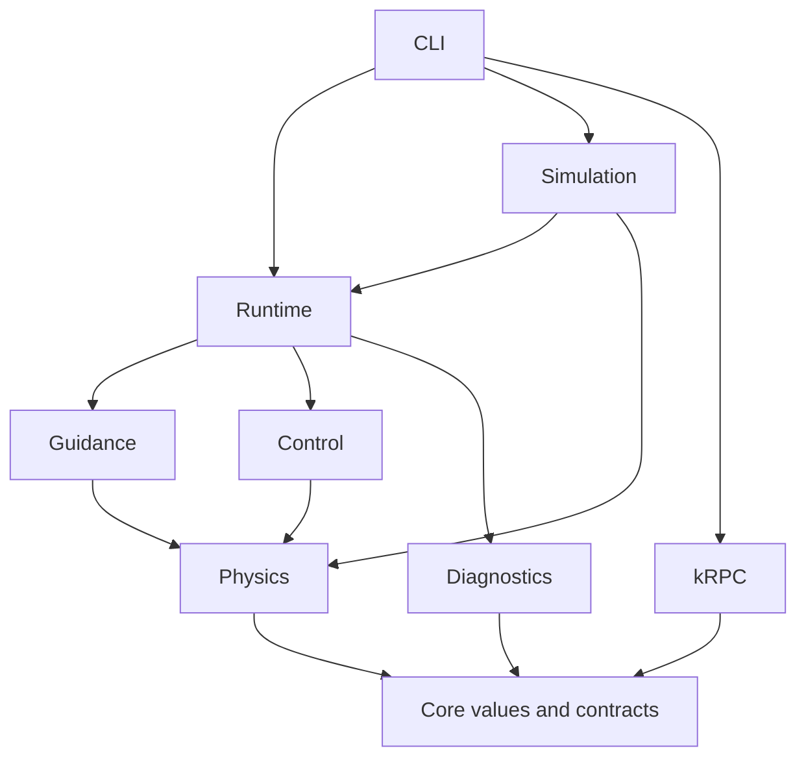

# Architecture, ownership, and concurrency

The package is an independent Swift 6 landing application. It has no dependency on the old KSL landing executable, Python guidance, the ascent system, or the OMS system. The supplied implementation was investigated as evidence for vehicle physics, wire compatibility, and past failures. Its mission-mode architecture was not retained.

## Modules

| SwiftPM target | Responsibility | Principal objects |
| --- | --- | --- |
| `KSLCore` | SI-valued snapshots, configuration, geometry, phases, commands, subsystem contracts | `VehicleState`, `Quaternion`, `RunwayFrame`, `FlightIO`, `TelemetryRecording` |
| `KSLPhysics` | Immutable environmental and aerodynamic models; owned plant integration | `AtmosphericModelEngine`, `AerodynamicsEngine`, `RotationalDynamicsEngine`, `TranslationalDynamicsEngine`, `ShuttlePhysicsEngine`, `TrajectoryPropagationEngine` |
| `KSLGuidance` | Entry prediction, terminal path search, energy pricing, tracking, approach, touchdown decisions | `EntryGuidanceEngine`, `EnergyManagementEngine`, `HACPlanningEngine`, `PathTrackingEngine`, `ApproachGuidanceEngine`, `LandingMissionController` |
| `KSLControl` | Surface commands, trim compensation, angular-rate tracking, saturation handling, rollout | `FlightController`, `RolloutController` |
| `KSLKRPC` | Native protobuf values and messages, framed TCP, discovery, coherent telemetry, ordered dispatch | `KRPCCodec`, `TCPTransport`, `KRPCSession`, `KRPCFlightIO` |
| `KSLDiagnostics` | Bounded JSONL recording, exact native replay, conservative archival import | `JSONLFileWriter`, `JSONLTelemetryRecorder`, `FlightReplayReader`, `LegacyTelemetryReader` |
| `KSLRuntime` | The common deterministic flight computer and the asynchronous live loop | `FlightComputer`, `FlightRuntime` |
| `KSLSimulation` | Scenario loading, plant substitution, dispersion injection, quantitative results | `SimulationScenario`, `SimulationEngine`, `SimulatedFlightIO` |
| `KSLLanding` | CLI composition and process lifecycle | `LandingCLI` |

The executable composes the modules. The guidance target contains no socket, file handle, or mutable reference. Networking does not import guidance. Physics does not choose mission phases. A simulation disturbance changes the plant while leaving the flight computer's nominal model unchanged.

## Object-oriented design

Stateful, identity-bearing components are `final class` objects or actors. The mission controller owns phase history and the committed terminal plan. The flight controller owns its bounded integral, filtered target rates, and previous surface command. The physics engine owns actuator history and the first touchdown event. The atmosphere and polar engines are immutable `Sendable` reference types, making expensive resource tables reusable without shared mutation.

Geometry and observations use value semantics. The flight state, aerodynamic state, control command, trajectory samples, terminal plan, configuration, and constraint reports are `struct` values. Finite alternatives use enums. `JSONLFileWriter.write<T: Encodable>` is generic because it records several concrete evidence types. Protocols sit at useful substitution boundaries: state acquisition, actuation/shutdown, telemetry recording, and transport. There is no protocol for every mathematical helper and no inheritance hierarchy of engines.

The synchronous `FlightComputer.step` is the sole composition of mission guidance and control. Both the offline `SimulationEngine` and the live `FlightRuntime` invoke it. `SimulatedFlightIO` also implements the same `FlightIO` contract as `KRPCFlightIO`, so the actor runtime can run against the plant. Historical inputs are translated into the same `VehicleState` value, with limitations attached to imported records.

## ARC ownership

Ownership is directed toward children:

| Owner | Owned resources | Release mechanism |
| --- | --- | --- |
| `FlightRuntime` actor | Flight computer, injected IO and recorder | Awaited shutdown and close on completion, timeout, error, and cancellation |
| `FlightComputer` | Mission controller and surface controller | Ordinary ARC after runtime disposal |
| `LandingMissionController` | Entry solver, terminal planner, tracker, approach engine, touchdown monitor, authority estimator, one committed plan | Ordinary ARC; plan replaced or cleared explicitly |
| `ShuttlePhysicsEngine` | Model engines, actuator state, ground model, one touchdown record | Ordinary ARC after a simulation |
| `KRPCFlightIO` actor | Session, discovered object references, latest snapshot, sequence state | Explicit `shutdown`; invalidation generation prevents an awaited operation from reviving a closed connection |
| `KRPCSession` actor | One transport and client identifier | Explicit `close`; errors close the session; reconnect performs a new handshake |
| `TCPTransport` | One POSIX descriptor | Explicit `close` and a fallback `deinit` |
| `JSONLFileWriter` | One `FileHandle` | Explicit flush and close, including a close attempt if flushing throws; fallback `deinit` |

There are no parent pointers, delegate cycles, singletons, global mutable flight state, `unowned` lifetime assumptions, or `@unchecked Sendable` annotations. `weak` references are used in ownership tests to establish release. Adding a weak field to production objects solely to demonstrate ARC would be unnecessary: the ownership graph is already acyclic.

The entry predictor's law closure is synchronous and nonescaping. Its capture of the entry engine ends before prediction returns. The signal handler captures a flight task, but the task does not capture the signal source. The CLI cancels the source when the awaited task finishes.

Cancellation cleanup uses one deliberately unstructured but immediately awaited task. This prevents an already-cancelled task from skipping neutralisation on a still usable connection. It is not detached, retained in a global registry, or allowed to outlive the enclosing run. Socket operations have bounded deadlines. A physically lost socket cannot deliver neutral controls; this is reported as a live integration limitation, not hidden by automatic command replay.

## Swift 6 isolation and ordering

The package selects Swift language mode 6. Actors isolate the runtime, the live adapter, the wire session, simulated IO, and asynchronous recording. Values crossing these boundaries conform to `Sendable`.

One control iteration is ordered as follows: acquire a coherent snapshot; check freshness, configuration, and forbidden systems; calculate guidance and control synchronously; check cancellation; dispatch one sequenced command; record it; sleep only until the next cadence deadline. There are no parallel guidance calculations racing to update the same mission. A command references the exact snapshot UT and has a strictly increasing sequence number. Duplicate or stale commands are rejected. Repeated UT values do not produce repeated commands and eventually fail the freshness deadline.

A session does not `await` within one request/response exchange. Its nonblocking socket uses bounded `poll` intervals, deadline checks, and cancellation checks. This deliberately serial design avoids response reordering. The adapter also rejects concurrent high-level operations and uses a connection generation to invalidate operations interrupted by shutdown.

## Resource and computation bounds

The normal plant step is 20 ms; the common guidance/control step is 100 ms. Entry and terminal replanning are normally spaced five seconds apart. A predictor is capped by duration and step count. Terminal search has a finite radius/turn-angle family and maximum route length. Only one active terminal plan, one best entry prediction, and bounded temporary candidate predictions are retained. Terminal tracking searches a short monotonically advancing station window, preventing a jump to a later overlapping spiral turn.

Recording is streaming. Native and legacy readers cap line size; the archival reader caps session count and invalidates broken delta chains. There is no retained full-flight history in the control loop. Validation scripts may retain full logs as compressed evidence, outside the flight computer.

Observed computation timings are in `Validation/matrix.json`. This is a soft real-time application on a general-purpose OS. The test host's timings do not establish a hard scheduling guarantee on a user's Mac or KSP host. An over-aged live snapshot is rejected before command dispatch.

## Extension boundaries

To add a different vehicle, supply a separately identified polar, inertia, control authority, gear geometry, and touchdown/braking envelope. Do not relabel the STS data as STS-N. To add another body, supply its atmosphere and rotation model and extend the live body-identity check; a different runway on Kerbin is already a configuration value. Replace the transport or `FlightIO` implementation without changing guidance. Replace the predictor with a stronger optimizer without introducing a second live-only guidance implementation. Every new capability should preserve full-rate replay and explicit uncertainty labels.
