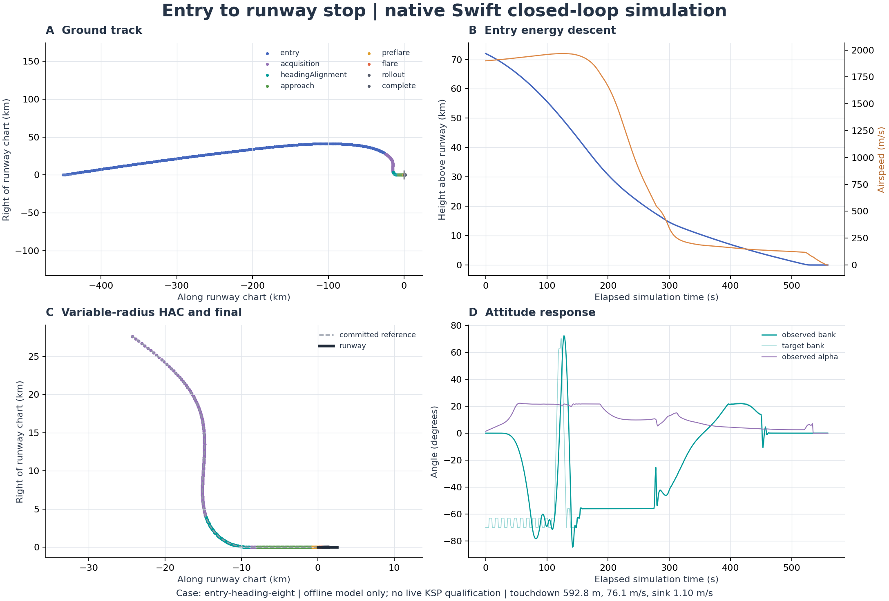
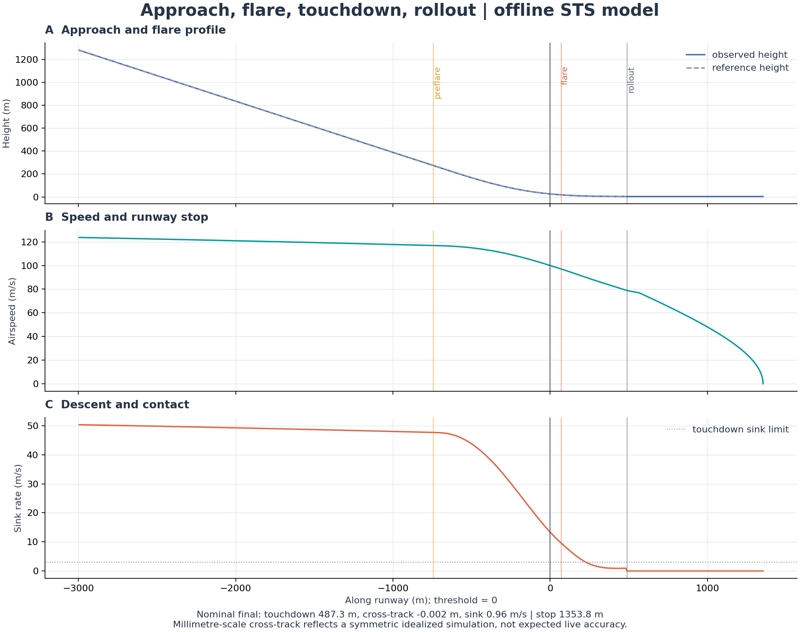

# Quantitative validation — final delivered source

## Evidence and overall result

The final Swift 6.0.3 Linux x86_64 build completed successfully. All **37 Swift tests** (26 XCTest and 11 Swift Testing cases) and **12 independent TCP protocol/failure cases** passed. **14 of 19 closed-loop scenario runs completed an acceptable touchdown and confirmed runway stop.** All six explicit regression gates passed.

The 19 cases are a deterministic engineering matrix, not random samples from a probability distribution. The completion fraction is not a statistical reliability estimate. The intentionally unreachable case and the archived heavier-vehicle mismatch remain in the table. No real KSP connection or live landing was performed.

Source SHA-256 values and the executable hash are in [matrix.json](../Validation/matrix.json). Test output is in [swift-tests.log](../Validation/swift-tests.log), toolchain identification in [toolchain.txt](../Validation/toolchain.txt), and independent wire results in [krpc-mock.json](../Validation/krpc-mock.json). These refer to the delivered source, not an earlier development experiment.

## Complete case matrix

Positions are metres from the Runway 09 threshold along the runway. Positive sink means downward velocity. Touchdown speed is horizontal ground speed. `complete` requires acceptable contact and a stop, not simply entering an approach phase. A `crashed` row can have contact measurements without an acceptable touchdown.

| Case | Outcome | Spiral flown | Touchdown x (m) | Horizontal speed (m/s) | Sink (m/s) | Stop x (m) |
| --- | --- | :---: | ---: | ---: | ---: | ---: |
| nominal-final | **complete** | no | 487.3 | 78.92 | 0.957 | 1353.8 |
| nominal-entry | **complete** | no | 521.0 | 75.03 | 1.060 | 1324.6 |
| entry-heading-eight | **complete** | yes | 592.8 | 76.13 | 1.103 | 1417.4 |
| required-spiral | **complete** | yes | 633.3 | 73.78 | 1.111 | 1416.5 |
| entry-downrange-plus100km | **complete** | no | 596.3 | 77.52 | 1.098 | 1440.5 |
| entry-crossrange15km | **aborted** | no | — | — | — | — |
| entry-speed-minus50 | **complete** | yes | 422.7 | 74.99 | 1.001 | 1226.6 |
| entry-speed-plus50 | **aborted** | no | — | — | — | — |
| entry-drag-plus10pct | **complete** | no | 433.5 | 67.16 | 0.970 | 1099.3 |
| entry-actuator-minus35pct | **crashed** | no | 1190.3 | 83.07 | 6.072 | — |
| final-lift-minus20pct | **complete** | no | 204.9 | 59.92 | 1.867 | 767.7 |
| final-drag-plus20pct | **complete** | no | 162.3 | 58.76 | 1.872 | 690.4 |
| final-drag-minus20pct | **complete** | no | 1094.3 | 91.01 | 1.271 | 2231.1 |
| final-density-plus10pct | **complete** | no | 291.1 | 80.33 | 1.021 | 1163.3 |
| final-crosswind5mps | **complete** | no | 478.8 | 78.94 | 0.947 | 1342.9 |
| low-energy-unreachable | **aborted** | no | — | — | — | — |
| historical-entry-20261028 | **complete** | yes | 525.1 | 72.94 | 1.066 | 1293.8 |
| historical-polar-20261029 | **complete** | no | 592.0 | 76.11 | 1.094 | 1416.2 |
| archival-heavy-final | **aborted** | no | — | — | — | — |

Exact inputs are saved under `Validation/scenarios/`; reports, final plans, and telemetry are under `cases/`, `plans/`, and `logs/`. The CSV includes peak q/load, saturation, computation timing, and source report hashes. All dimensions and disturbances are also recorded in each row's arguments.

The nominal synthetic entry starts 450 km before the runway at 72 km height, 1,900 m/s, and −3° flight-path angle. The heading case adds 8°. The downrange case starts 100 km farther away. The cross-range case adds 15 km right offset and 3° heading error. The low/high speed cases change entry speed by −/+50 m/s. The final-only baseline starts 10 km before the threshold at 4,200 m height, 150 m/s, and −24° flight-path angle.

`required-spiral` starts 24 km before and 4 km right of the runway at 12 km height, 220 m/s, −20° heading error, and −24° flight-path angle, with direct terminal paths disabled. The two historical entry cases use the supplied recorded initial-condition INI files. Their new results remain offline simulations.

## Failure interpretation

- **Cross-range 15 km / heading 3°:** no complete terminal route was captured before the modeled optimistic range bound was exceeded. This exposes a remaining entry/search-envelope failure; it is not proof that the original state is physically unreachable.
- **Entry speed 1,950 m/s:** entry energy/geometry did not converge to a complete terminal path; the mission aborted at low altitude. The bounded candidate policy is not qualified for this case.
- **Actuator authority reduced by 35%:** contact occurred on the runway at 1,190.3 m and 83.07 m/s, but sink was 6.072 m/s, exceeding the 3 m/s contact limit. It is correctly classified as a crash, not a successful landing. Force-effectiveness correction does not identify or compensate all moment/actuator degradation.
- **Low-energy unreachable:** the initial state is 120 km away, 1 km high, and 70 m/s. The modeled optimistic range is only about 6.33 km. Immediate rejection is the expected regression outcome; no landing is counted.
- **Archived heavy final:** the 40,252.9 kg STS-N starting condition is not qualified by the 25 t STS model. No complete terminal capture was found; the run aborted. It is retained to make that model boundary visible.

Classified failures and the last terminal rejection summary are present in each report. A correct abort classification does not establish that preceding guidance was optimal or that neutralization provides a safe emergency landing.

## Spiral evidence

The following successful runs entered and completed the heading-alignment segment. The radial parameter is `Rf + k*theta²`; local curvature radius is a different quantity. These particular flown spirals do not establish that every multi-revolution candidate can be flown. Geometry unit tests separately include 450° curves.

| Case | Turn parameter (deg) | Entry radial parameter (m) | Final radial parameter (m) | Growth k (m/rad²) |
| --- | ---: | ---: | ---: | ---: |
| entry-heading-eight | 100 | 5741.6 | 3000.0 | 900.0 |
| required-spiral | 60 | 9296.1 | 9000.0 | 270.0 |
| entry-speed-minus50 | 150 | 3616.9 | 3000.0 | 90.0 |
| historical-entry-20261028 | 60 | 6713.8 | 6500.0 | 195.0 |



## Numerical and resource checks

The plant integrates translation with RK4 and midpoint attitude/rate at a nominal 20 ms substep; guidance/control runs at 100 ms. The vacuum orbital-energy relative-error test passes at 1e−9 tolerance over 1,000 s. The rotating-frame angular-momentum relative-error test passes at 1e−5 tolerance over 100 s. The 10 ms/20 ms final-approach refinement test completes both landings with touchdown-position difference below 15 m, horizontal-speed difference below 1 m/s, and sink difference below 0.2 m/s. These are test bounds, not asserted measured equalities to the limits.

Full-rate nominal-final replay processed **1168 records with 0 command/guidance mismatches**. The exact same `FlightComputer.step` generated the original and replayed outputs. Same-build determinism is demonstrated; bitwise identity across different architectures/compilers is not asserted. Wall-clock timing fields are intentionally not deterministic.

Unit and lifecycle checks also cover frame round trips, handedness, drag removing energy, no artificial vacuum control, analytic spiral curvature, C2 joins/capture, impossible paths, initial curvature measured against integrated plant acceleration, normal pullout acceleration, force-estimator convergence, ARC release, malformed/oversized data, read/write failure, frozen telemetry, command sequence, cancellation, and explicit close.

The largest observed flight-computer step in the matrix was **410.7 ms**. Per-case mean compute times ranged from 0.0033 to 1.9403 ms. Planning spikes exceed the 100 ms nominal control period. The live adapter rejects commands older than 500 ms, but these host timings do not prove hard real-time operation under actual KSP load.

## Envelope, model uncertainty, and interpretation

Across this matrix, maximum sampled controller-step q was **22.81 kPa**, and maximum normal load was **2.577 g**. The configured q/load limits are 45 kPa and 3.5 g. These peaks do not include unmodeled heating or structural constraints.

All 8,432 saved telemetry records complied with the unpowered-system policy and contained no airborne wheel-brake commands or nonfinite kinematics/attitude/commands. Full control validation also runs inside the Swift loop. Sampled absolute bank reached **89.35°** despite a 70° target limit; low-q attitude transients can overshoot requested bank. The target bound is not an observed-attitude guarantee. Details are in [telemetry-audit.json](../Validation/telemetry-audit.json).

Every selected terminal plan in this matrix fails at least one of its two configured opposing ±20% lift/drag corner assessments. Those failures are preserved as `modelUncertainty` warnings. Nominal completion and success in individual disturbance runs therefore do not constitute a robust-feasibility certificate. The corner tests are not measured confidence intervals.

Reduced-lift and increased-drag final-only cases touch down more slowly than the nominal 85 m/s design speed. They remain acceptable under the implemented contact limits, but this does not establish stall, gear, or structural margin in KSP. The low-drag final stops at 2,231.1 m on a 2,500 m runway, leaving approximately 268.9 m; the reduced-lift final reaches 13.32° pitch, close to the 14° contact limit. Those margins matter more than a bare success count.

The millimetre-scale cross-track values in symmetric runs reflect an idealized deterministic model, precise state, and smooth runway. They are not a prediction of live navigation accuracy. Ground suspension, wheel slip, airbrake part mapping, live moments, and real timing remain unverified.



## Reproduction

```sh
bash Tools/run-validation.sh
python3 Tools/plot_validation.py
python3 Tools/summarize_validation.py
```

The scripts use only the built native Swift executable, Python's standard library, and Matplotlib for plots. The loopback fixture binds its own temporary port and does not contact an existing KSP server. The full-rate replay log can be decompressed from `Validation/logs/nominal-final.jsonl.gz`. All other matrix logs are sampled evidence and are not full-rate command-replay inputs.

The precise outstanding functionality is listed in [Known-Limitations.md](Known-Limitations.md). Original-data limitations and raw log audit counts are in [Reference-Audit.md](Reference-Audit.md).
